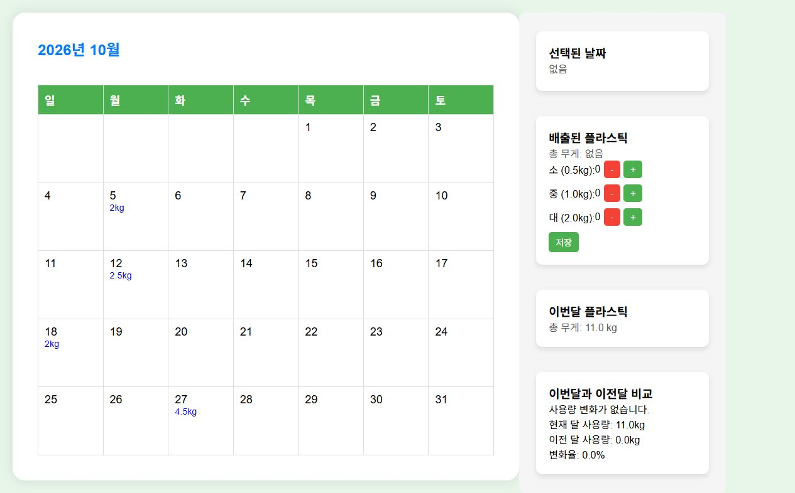

# Plastic Use Tracker Calendar

달력에서 날짜별 플라스틱 배출량을 기록하고, 월별 사용량과 이전 달 대비 변화를 확인할 수 있는 웹 애플리케이션입니다.

## 실행 화면

날짜별 배출량을 기록하면 달력에 무게가 표시되고, 오른쪽에서 해당 월의 총사용량과 이전 달 비교 결과를 확인할 수 있습니다.



## 주요 기능

- 날짜별 플라스틱 배출량 기록
- 소형(0.5kg), 중형(1.0kg), 대형(2.0kg) 단위로 수량 입력
- 기록한 무게를 달력에 표시
- 선택한 달의 총 배출량 집계
- 현재 달과 이전 달의 배출량 및 변화율 비교
- SQLite를 이용한 로컬 데이터 저장

## 기술 스택

- Frontend: HTML, CSS, Vanilla JavaScript
- Backend: Node.js, Express
- Database: SQLite

## 실행 방법

### 요구 사항

- Node.js 22.5 이상 권장
- npm

현재 서버는 Node.js 내장 SQLite 모듈인 `node:sqlite`를 사용합니다. 이전 Node.js 버전에서는 실행되지 않을 수 있습니다.

### 설치 및 실행

```bash
git clone https://github.com/JUNE2001/Plastic-Use-Tracker-Calendar.git
cd Plastic-Use-Tracker-Calendar
npm install
npm start
```

브라우저에서 다음 주소로 접속합니다.

```text
http://localhost:3000
```

### 다른 포트 사용

기본 포트는 `3000`입니다. 해당 포트를 이미 사용 중이라면 `PORT` 환경변수로 변경할 수 있습니다.

PowerShell:

```powershell
$env:PORT = 4174
npm start
```

macOS 또는 Linux:

```bash
PORT=4174 npm start
```

## 사용 방법

1. 달력에서 기록할 날짜를 선택합니다.
2. 소·중·대 버튼으로 플라스틱 배출 수량을 입력합니다.
3. `저장` 버튼을 누릅니다.
4. 저장된 총무게가 해당 날짜와 월별 요약에 반영됩니다.
5. 달력 상단의 연도와 월을 클릭하면 원하는 기간으로 이동할 수 있습니다.

같은 날짜에 다시 저장하면 기존 기록을 새 값으로 교체합니다.

## API

| Method | Endpoint | 설명 |
| --- | --- | --- |
| `POST` | `/save` | 날짜별 플라스틱 사용량 저장 또는 교체 |
| `GET` | `/data?date=YYYY-MM-DD` | 특정 날짜의 기록 조회 |
| `GET` | `/monthly-data?year=YYYY&month=M` | 특정 월의 날짜별 무게 조회 |
| `GET` | `/monthly-comparison-data?year=YYYY&month=MM` | 현재 달과 이전 달의 총량 조회 |

`POST /save` 요청 예시:

```json
{
  "date": "2026-10-27",
  "smallCount": 2,
  "mediumCount": 1,
  "largeCount": 1,
  "totalWeight": 4.0
}
```

## 프로젝트 구조

```text
Plastic-Use-Tracker-Calendar/
├── public/
│   ├── calendar.html      # 메인 화면
│   ├── script.js          # 달력 및 API 연동 로직
│   └── styles.css         # 화면 스타일
├── server.js              # Express 서버와 SQLite API
├── plastic_usage.db       # 로컬 SQLite 데이터베이스
├── package.json
└── package-lock.json
```

## 데이터 보관

입력한 기록은 프로젝트 루트의 `plastic_usage.db`에 저장됩니다. 데이터를 유지하려면 이 파일을 삭제하지 마세요. 중요한 기록은 파일을 별도로 백업하는 것을 권장합니다.

## 문제 해결

### `EADDRINUSE` 오류

3000번 포트를 다른 프로그램이 사용 중이라는 의미입니다. 해당 프로그램을 종료한 후 다시 실행하거나 다른 포트를 사용하세요.

### 화면은 열리지만 저장이나 조회가 되지 않는 경우

- 서버가 실행 중인지 확인합니다.
- 기본 주소 `http://localhost:3000`으로 접속했는지 확인합니다.
- 브라우저 개발자 도구의 Console과 Network 탭에서 API 오류를 확인합니다.

### 기존 `sqlite3` 바이너리 오류

저장소에 포함된 오래된 `node_modules`는 운영체제 또는 Node.js 버전과 맞지 않을 수 있습니다. 기존 폴더를 제거한 후 현재 환경에서 의존성을 다시 설치하세요.

```bash
npm install
```

## 라이선스

현재 저장소에는 별도의 라이선스가 명시되어 있지 않습니다.
